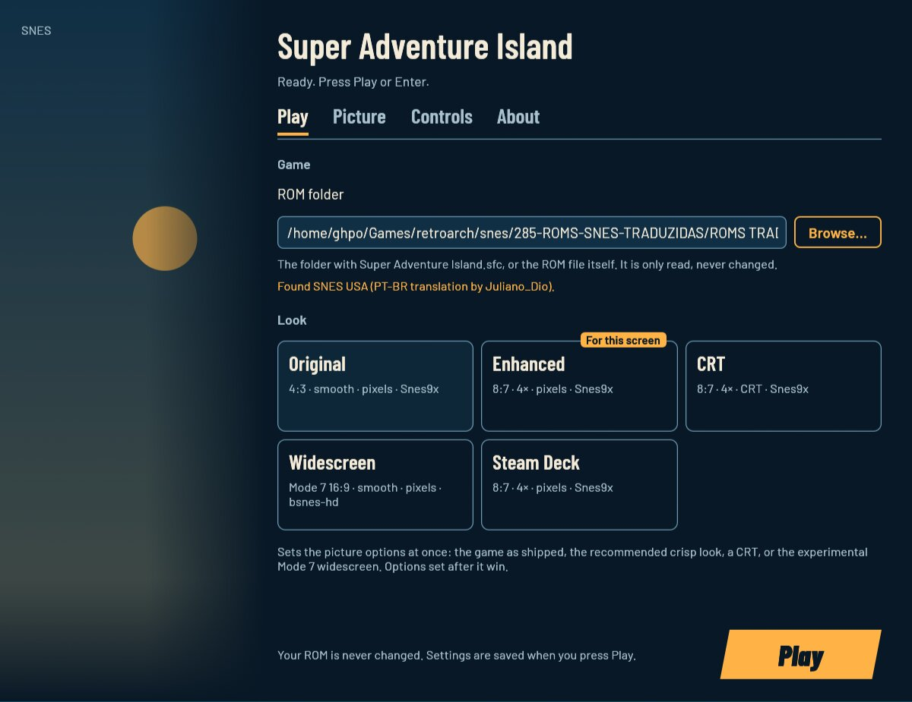
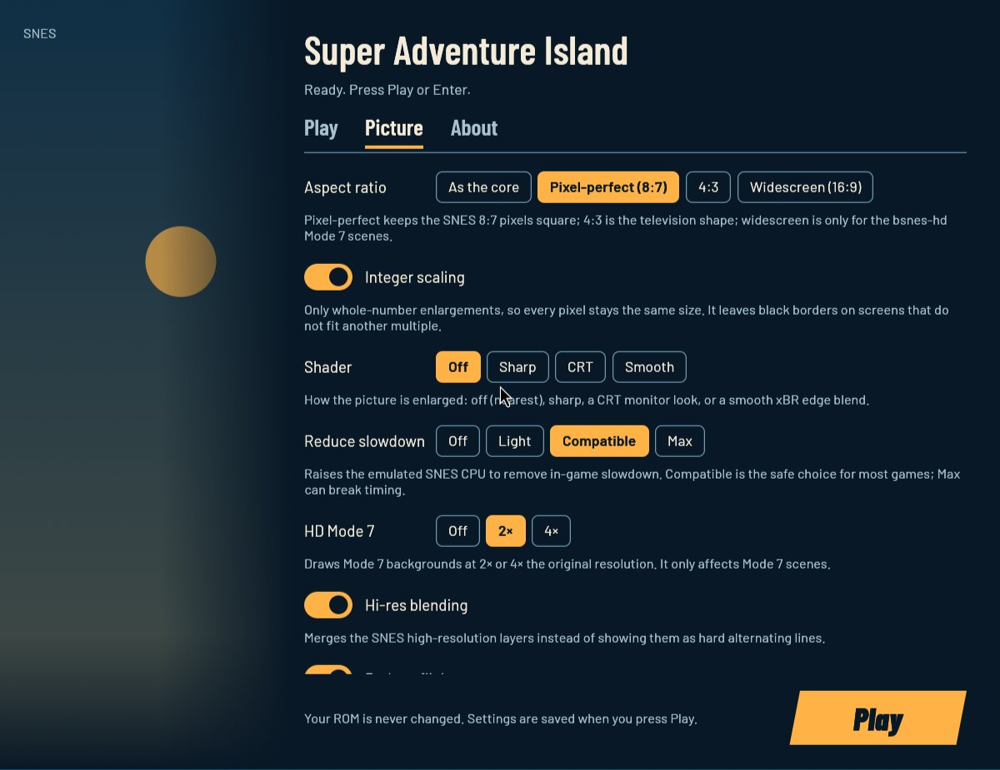
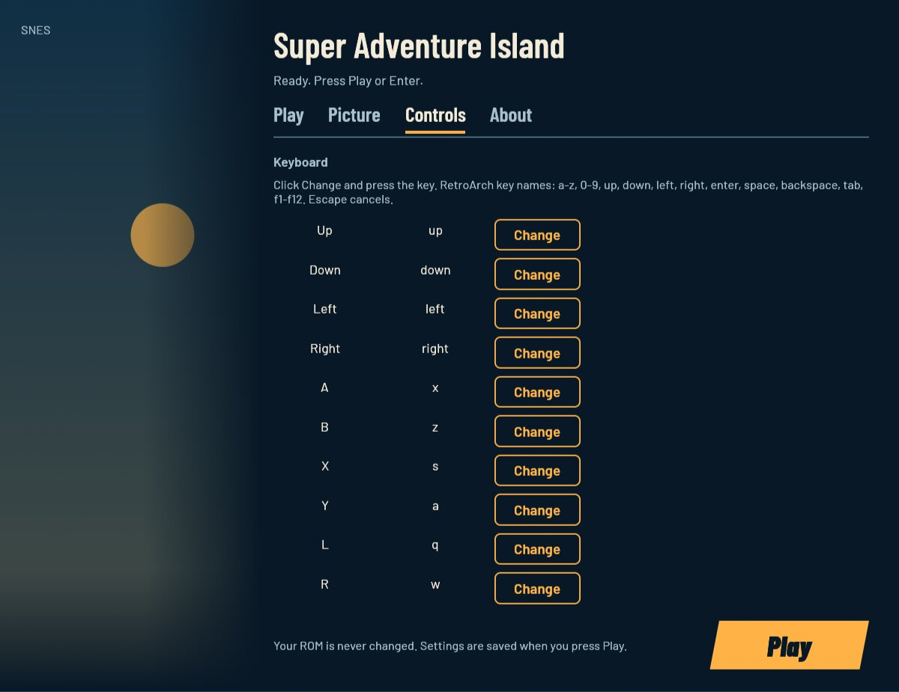
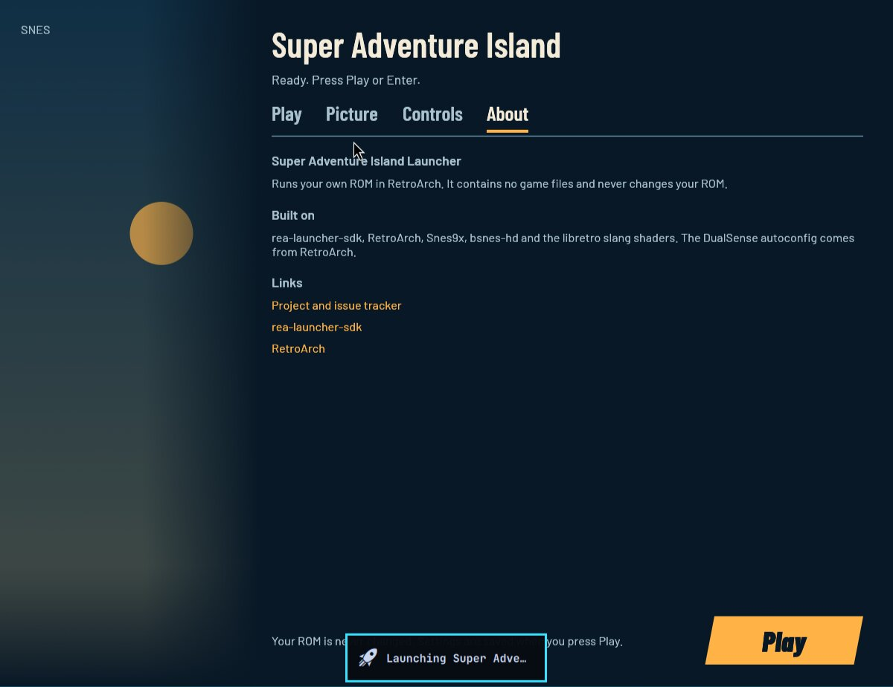
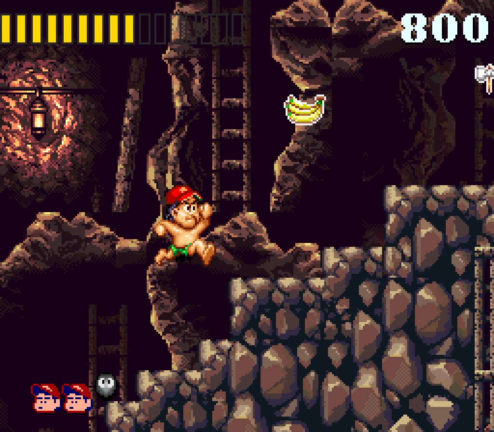
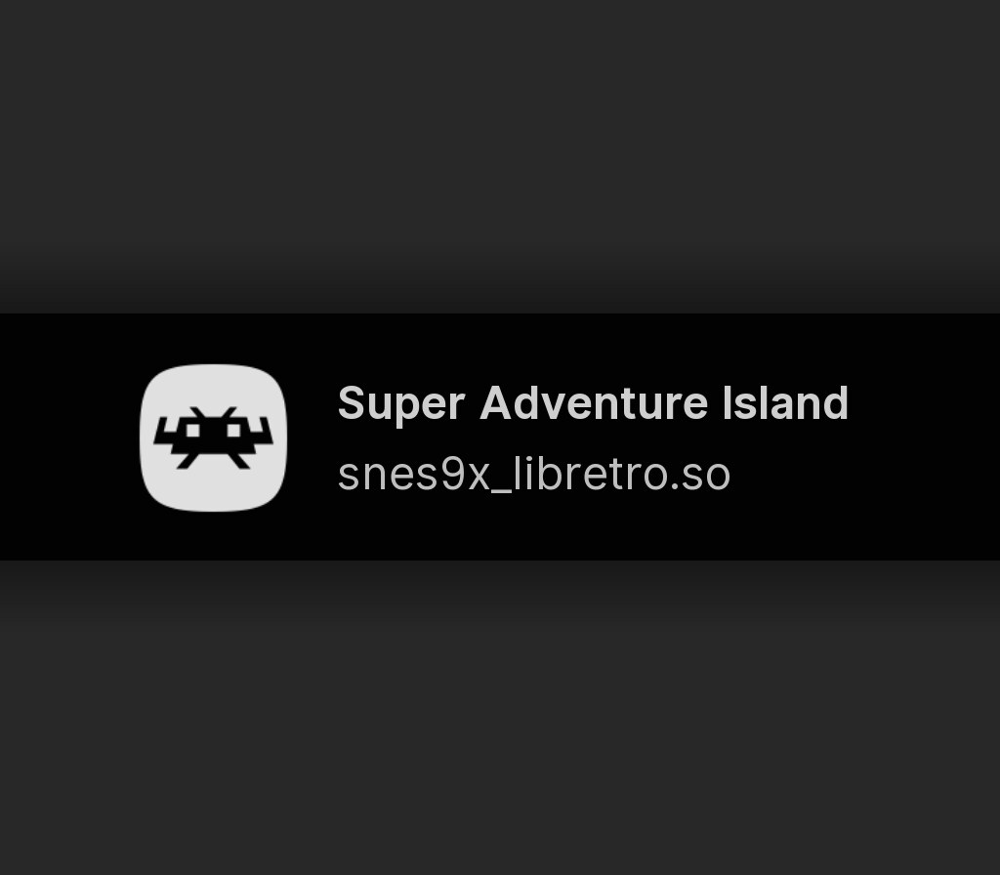

# Super Adventure Island Launcher

Play **your own copy** of Super Adventure Island (SNES) on Linux and
Windows with a settings window, sensible defaults and no manual emulator
setup. The launcher reads your ROM, writes its own RetroArch configuration
and starts the game with the Snes9x core. It contains no game files.

> Verified end to end on the owner's Linux laptop: the PT-BR translation,
> the first level at 60 fps and the Enhanced look; the CRT shader on the
> title screen. The Windows package was built and its tests pass under
> Wine; the visual run in the owner's Windows VM is the remaining check
> (see [docs/RUNTIME_NOTES.md](docs/RUNTIME_NOTES.md)).

## Problems this launcher solves

| Problem | What the launcher does |
| --- | --- |
| An emulator needs a core, shaders and a per-game configuration before it looks right. | Finds the installed RetroArch and cores, or uses the bundled Windows copy, and writes a private configuration for this ROM. |
| RetroArch's default 4:3 output and fractional monitor scaling soften the SNES pixels. | **Enhanced** draws 8:7 at the largest integer multiple (4× = 1024×896 on 1080p), and on Hyprland it sets the monitor to scale 1 while the game runs, restoring it afterwards. |
| Some spots slow down on real hardware. | Snes9x's **Reduce slowdown** overclock (`Compatible` in Enhanced) and run-ahead for input latency. |
| The game looks bare on a modern screen. | Optional **CRT** (`zfast-crt`), **Sharp** and **Smooth** (xBR) shaders, HD Mode 7 2×/4× and hi-res blending. |
| A 4:3 picture on a wide screen. | The experimental **Widescreen** look uses bsnes-hd's 16:9 Mode 7 widening. Ordinary side-scrolling levels stay 4:3. |
| Patching a ROM or a global emulator configuration risks your copy. | The ROM is only read; settings, core options, saves and states live in the launcher's own folders. |
| An unknown ROM or a bad dump starts and behaves strangely. | Every ROM is identified by SHA-256; an unknown build is refused with its digest and a report link. |

## Screenshots

| Play | Picture | Controls | About |
| :---: | :---: | :---: | :---: |
|  |  |  |  |





## What you need

- Your own **Super Adventure Island** ROM (the USA/NTSC `Super Adventure
  Island.sfc`). This repository ships none and never copies yours into
  itself.
- **Linux:** RetroArch, the Snes9x core and (for the CRT/Sharp/Smooth
  looks) the slang shaders. On Arch:

  ```sh
  sudo pacman -S retroarch libretro-snes9x libretro-shaders-slang libretro-bsnes-hd
  ```

  `jq` is used by the optional Hyprland fractional-scale fix; the game runs
  without it.
- **Windows:** use the packaged zip, which already contains RetroArch
  1.22.2, the Snes9x/bsnes-hd cores and the slang shaders. Nothing to
  install.

## Download and install

### Linux (native)

The launcher is a native Linux program; it is not a Wine/Proton game.

```sh
cargo build --release --locked
linux/sai-play                 # settings window, then the game
linux/sai-play --play          # game with the saved settings
linux/sai-play stop            # end the session
linux/sai-play status          # running or idle
```

`linux/sai-play` needs `sdk/rea-play.sh` beside it (a repository checkout
has it in `../sdk/`). A packaged release also carries the launcher binary
and the helper; see [linux/README.md](linux/README.md).

The `sai-launcher.desktop` entry opens the settings window; add
`~/.local/share/sai-launcher/sai-play --play` as a non-Steam game in Steam
for the direct game shortcut. The helper uses the system RetroArch.

### Windows

Unzip the release package (or the `dist/SAILauncher-Windows.zip` produced
for the owner) anywhere, copy your ROM to a folder the launcher may read,
run `SAILauncher.exe`, press **Browse…** and pick the folder with the
`.sfc`. The package contains RetroArch and the cores in
`RetroArch-Win64/`; nothing is installed system-wide.

The settings window uses **D3D12 through wgpu**, not OpenGL, so it also
opens in VMs whose display driver has no OpenGL (the owner's VM). If the
window still cannot open, the `--no-window` commands below play from the
saved/auto-detected settings.

The launcher also looks for the ROM in a `roms` folder next to the exe or
one level above it (the owner's `C:\Games\SAILauncher\roms` layout), and
accepts `Super Adventure Island (USA).sfc`/`.smc` as well as the exact name.
If the saved choice is missing or no longer works, it auto-detects and shows
the found path.

If the settings window cannot open (a VM without OpenGL), the launcher still
plays from the command line:

```bat
SAILauncher.exe --no-window --linux --game "C:\Games\SAILauncher\roms" --look enhanced
```

The first run remembers the ROM; afterwards `SAILauncher.exe --no-window`
(or `--no-window --linux` if the window is unavailable) is enough. Without
`--game`, the auto-detect uses the `roms` folder next to/above the exe.

### Steam Deck

The same Linux helper works in Desktop Mode and Game Mode; the **Steam
Deck** look is recommended on the Deck's screen. Game Mode, suspend/resume
and the Deck's pad have not been verified yet (see `docs/RUNTIME_NOTES.md`).

## First run

1. Under **Game**, pick the folder with `Super Adventure Island.sfc` (or
   type the `.sfc` path itself).
2. Pick a look: **Enhanced** is recommended, **Steam Deck** on a Deck.
3. Press **Play** (Enter, or Start on a pad).

`--check` identifies the ROM and prints its edition without launching:

```sh
linux/sai-play --check --game "/path/to/roms"
```

## The settings window

- **Play:** the ROM folder/file and the look cards.
- **Picture:** aspect ratio, integer scaling, shader, reduce slowdown, HD
  Mode 7, hi-res blending, reduce flicker, widescreen, VSync, run-ahead,
  fullscreen, core and Show FPS.
- **Controls:** keyboard bindings for the twelve SNES buttons and the
  controller layout.
- **About:** credits and links.

The window works with the keyboard (Tab moves, arrows change, Space
switches, Ctrl+Tab changes tab, Enter plays) and with a pad (d-pad moves,
A switches, LB/RB change tab, Start plays). A greyed-out choice says why on
the window.

## Options

### Looks

| Look | What it sets | When to pick it |
| --- | --- | --- |
| **Original** | 4:3, no shader, no overclock, no HD Mode 7, no widescreen | The game as it shipped. |
| **Enhanced** | 8:7, integer 4×, no shader, Reduce slowdown `Compatible`, HD Mode 7 2×, hi-res blending, reduce flicker, run-ahead 2 | Recommended default: **sharp, pixel-perfect** pixels without a shader; the change is subtle next to a plain 4:3 picture. |
| **CRT** | Enhanced + `zfast-crt` | The visible retro look: scanlines/mask. Pick it when "melhorado" means CRT. |
| **Widescreen** | bsnes-hd, 16:9 Mode 7, HD Mode 7 | Experimental; only Mode 7 scenes widen. |
| **Steam Deck** | Enhanced sizes | The Deck's 1280×800 screen. |

| `launcher.cfg` / flag | Values | Unset | What it changes |
| --- | --- | --- | --- |
| `game` / `--game` | a folder or `.sfc` | none | The ROM. Only read. |
| `look` / `--look` | `original`, `enhanced`, `crt`, `widescreen`, `steam_deck` | none (first run saves Enhanced) | Sets all picture options; later options win. |
| `aspect` / `--aspect` | `pixel` (8:7), `4:3`, `widescreen` | the core's own | The SNES pixel shape. |
| `integer_scale` / `--integer-scale` | `on`, `off` | the core's own | Whole-number enlargement only. |
| `shader` / `--shader` | `off`, `sharp`, `crt`, `smooth` | off | The shader preset. |
| `overclock` / `--overclock` | `off`, `light`, `compatible`, `max` | off | Snes9x's Reduce slowdown. |
| `mode7_hd` / `--mode7-hd` | `off`, `2x`, `4x` | off | HD Mode 7. |
| `hires_blend` / `--hires-blend` | `on`, `off` | the core's own | Snes9x hi-res blending. |
| `reduce_flicker` / `--reduce-flicker` | `on`, `off` | the core's own | More sprites; fewer blink-outs. |
| `widescreen` / `--widescreen` | `on`, `off` | off | bsnes-hd Mode 7 widescreen. |
| `vsync` / `--vsync` | `on`, `off` | the core's own | Wait for the screen. |
| `run_ahead` / `--run-ahead` | `0`, `1`, `2` | off | RetroArch run-ahead frames. |
| `fullscreen` / `--fullscreen` | `on`, `off` | the core's own | Fullscreen or a window. |
| `core` / `--core` | `auto`, `snes9x`, `bsnes_hd` | auto | Auto: bsnes-hd only with widescreen. |
| `show_fps` / `--show-fps` | `on`, `off` | off | The frame-rate counter. |
| `saves` / `--saves` | a folder | the launcher's data folder | Save files and states. |
| `runtime` / `--runtime` | a folder | the launcher's data folder | Generated config and logs. |
| `retroarch` / `--retroarch` | a program | found on PATH / in the Windows package | The RetroArch program. |
| `core_dir` / `--core-dir` | a folder | the system's / the Windows package's | Where the core DLLs/SOs are. |
| `shader_dir` / `--shader-dir` | a folder | the system's / the Windows package's | The slang shader root. |

The game is NTSC/USA and runs at about 60.1 Hz; **no 60 fps patch is
needed**. On a 60 Hz screen, 60 is the ceiling.

## Controls

The **Controls** tab remaps the keyboard for Up/Down/Left/Right, A/B/X/Y,
L/R and Start/Select: click **Change** and press the key; **Escape**
cancels; **Reset controls** restores the defaults (RetroArch's
`x/z/s/a/q/w/Enter/Backspace` and the arrows).

The controller is **Auto** by default: RetroArch's system autoconfig (the
player's DualSense on Linux, XInput on Windows). The **Nintendo (SNES A/B)**
and **Xbox (A = A, B = B)** presets set the standard pad's face and shoulder
buttons explicitly. A fully custom pad button map belongs in RetroArch's
own Input settings; the launcher never edits the player's RetroArch input
configuration.

Both values live in `controls.cfg` beside `launcher.cfg` and are written
into the private RetroArch configuration when you press Play.

## Where things live

| What | Linux | Windows |
| --- | --- | --- |
| Settings (`launcher.cfg`), controls (`controls.cfg`), log (`launcher.log`) | `~/.config/sai-launcher/` | `%APPDATA%\SAILauncher\` |
| Runtime configuration, states, logs | `~/.local/share/sai-launcher/runtime/` | `%LOCALAPPDATA%\SAILauncher\runtime\` |
| Saves | `~/.local/share/sai-launcher/saves/` | `%LOCALAPPDATA%\SAILauncher\saves\` |
| The ROM | wherever you keep it | wherever you keep it |
| The launcher's copy of the game | none (the ROM is read in place) | none |

The launcher never writes to the ROM folder. Your existing RetroArch
configuration (`~/.config/retroarch/`) is not changed; the launcher uses its
own `--config` and its own core-options folder.

## Troubleshooting

- **RetroArch/core not found on Linux.** Install the Arch packages above,
  or pass `--retroarch`, `--core-dir` and `--shader-dir`.
- **The settings window does not open on Windows.** Since the wgpu/D3D12
  change it opens without OpenGL; if it still fails, use the `--no-window`
  command; the launcher's configuration and auto-detected ROM still work.
- **The picture does not look "better".** Enhanced is sharp integer
  scaling, not a shader; choose **CRT** or **Smooth** in the menu, or run
  `SAILauncher.exe --no-window --linux --look crt` (the CLI uses the
  auto-detected ROM).
- **The launcher says it cannot find the ROM.** Point **Browse…** at the
  folder that directly contains the `.sfc` (the `roms` folder, not its
  parent). The new launcher also searches `roms` beside/above the exe and
  common `Super Adventure Island*.sfc`/`.smc` names; if the file is still
  refused, its SHA-256 is shown in `launcher.log` (the edition table may not
  know that build).
- **The picture is soft / has black bars.** Enhanced is 8:7 integer 4× with
  black borders; pick `aspect = 4:3` and integer scaling off for an
  edge-to-edge 4:3 picture.
- **The scale stays wrong after a crash on Hyprland.** The helper restores
  it on every exit path; if the process was killed with SIGKILL, set the
  monitor scale back to 1.25 in your Hyprland config. The launcher's direct
  runs also restore it.
- **Widescreen does nothing in a normal level.** It only widens Mode 7
  scenes; the side-scrolling levels stay 4:3.
- **The controller does nothing.** Keep the layout on **Auto** (the system
  autoconfig: DualSense on Linux, XInput on Windows) and check the pad in
  RetroArch's Input settings. The launcher's keyboard remaps are in the
  **Controls** tab and `controls.cfg`.
- **Read the logs.** `~/.config/sai-launcher/launcher.log` and
  `~/.local/share/sai-launcher/runtime/logs/retroarch.log` (Windows:
  `%APPDATA%\SAILauncher\launcher.log`,
  `%LOCALAPPDATA%\SAILauncher\runtime\logs\retroarch.log`).

## Known limitations

- The ROM in the edition table is the owner's **PT-BR translation by
  Juliano_Dio**. The original USA ROM is not in the table yet; an unknown
  ROM is refused with its SHA-256.
- Widescreen is bsnes-hd's experimental Mode 7 widening; 2D levels stay
  4:3 and some Mode 7 scenes may need a different widescreen setting.
- On Hyprland with fractional scaling the game runs while the focused
  monitor is set to scale 1; the helper restores it. This is Hyprland
  specific.
- The Windows VM visual run is pending; the Windows build, the package
  layout and the Windows-target tests were verified under Wine. If the VM
  has no OpenGL, the settings window uses the fallback command line.
- The controller presets assume the standard DualSense (Linux)/Xbox
  (Windows) button indices; use **Auto** for any other pad, or configure the
  pad in RetroArch's Input settings.
- No HD texture pack, MSU-1 soundtrack or ROM hack is included; the
  launcher is for the game as it is.
- The Steam Deck was not tested on real hardware.

## Uninstall

- **Linux:** delete `~/.config/sai-launcher`,
  `~/.local/share/sai-launcher`, the two `.desktop` entries and the
  `~/.local/bin/sai-play` link. Your ROM is untouched.
- **Windows:** delete the unzipped folder, `%APPDATA%\SAILauncher` and
  `%LOCALAPPDATA%\SAILauncher`. Your ROM is untouched.

## For developers

The launcher is Rust, built on the rea-launcher-sdk v0.4.3, with a native
egui window on both platforms. It writes a private RetroArch configuration
and runs RetroArch; nothing is patched in the ROM.

```sh
cargo fmt --all --check
cargo test --workspace --locked
cargo clippy --workspace --all-targets -- -D warnings
sdk/scripts/launcher-check
../rea-launcher-sdk/scripts/sdk-sync --check .
```

The Windows target (`x86_64-pc-windows-gnu`) needs MinGW-w64, lld and the
Rust target; the launcher enables eframe's `wgpu` feature and selects the
D3D12 renderer on Windows (Linux keeps glow). The owner used a Docker image
with the SDK's toolchain. The
Windows tests were built there and run with the host's Wine 11 (the SDK's
`wine-test` container's older Wine lacks `bcryptprimitives.dll`):

```sh
cargo build --release --locked --target x86_64-pc-windows-gnu
# then run target/.../deps/*.exe with wine, or the SDK wine-test with Wine >= 9
```

The Windows package inputs are pinned in `packaging/windows-pins.txt`
(RetroArch 1.22.2 `RetroArch.7z` and `RetroArch_cores.7z`, with SHA-256).
The launcher is at `crates/sai-launcher`; the Linux helper at
`linux/sai-play`; the runtime/core-options writer at
`crates/sai-launcher/src/retroarch.rs`; the Controls tab and `controls.cfg`
at `crates/sai-launcher/src/controls.rs`.

## Built on rea-launcher-sdk

The option table, settings window, save/runtime layout, single-instance
guard, Linux play helper, snapshots and packaging structure come from
[rea-launcher-sdk](https://github.com/akitaonrails/rea-launcher-sdk) v0.4.3,
pinned in `Cargo.toml` and vendored in `sdk/`. The game-specific parts are
the ROM edition table, the RetroArch configuration/core-options writer and
the looks.

## Contributing

- **The launcher, the ROM edition table, the looks and the retroarch
  configuration:** open an issue or pull request here.
- **Shared code** (the settings-window widgets, the option table, the play
  helper, `rea-play.sh`, packaging): report it at
  [rea-launcher-sdk](https://github.com/akitaonrails/rea-launcher-sdk/issues).
- Never attach the ROM, a save or any game file to an issue. Report the
  SHA-256 of an unknown ROM, never the file.

## Credits

- [RetroArch](https://www.retroarch.com) and the libretro project: the
  emulator frontend and the slang shaders.
- [Snes9x](https://github.com/libretro/snes9x) and
  [bsnes-hd](https://github.com/DerKoun/bsnes-hd): the SNES cores.
- The Barlow fonts by Jeremy Tribby (SIL OFL), through rea-launcher-sdk.
- Juliano_Dio: the PT-BR translation in the owner's ROM.
- [rea-launcher-sdk](https://github.com/akitaonrails/rea-launcher-sdk).

Full list with licences: [THIRD_PARTY.md](THIRD_PARTY.md).

## Legal

Super Adventure Island is © Hudson Soft / Nintendo and its rights holders.
This project is not affiliated with or endorsed by them. It contains no
game files and only runs a copy the player owns. The launcher's code is
MIT OR Apache-2.0; bundled third-party parts keep their own licences
([THIRD_PARTY.md](THIRD_PARTY.md)).
